<div align="center">


# Tabak İz

**Bir tabak fotoğrafı, daha az israf.**

Okul yemekhanesinde tabak artığını Gemini ile ölçen, çocuğa iklim odaklı ve sesli geri bildirim veren, mutfağa ne kadar pişireceğini söyleyen ve etkiyi ölçerek raporlayan mobil web uygulaması.

*AI-powered school plate-waste measurement: Gemini vision, child-friendly voice feedback, kitchen forecasting and measurable impact. Available in Turkish and English.*

Climathon 2026 · COP31 × Siemens × UP School
COP31: *Cutting waste by half by 2035* · Siemens: *Resource Efficiency & Circularity* · SDG 12.3

</div>

---

<p align="center">
  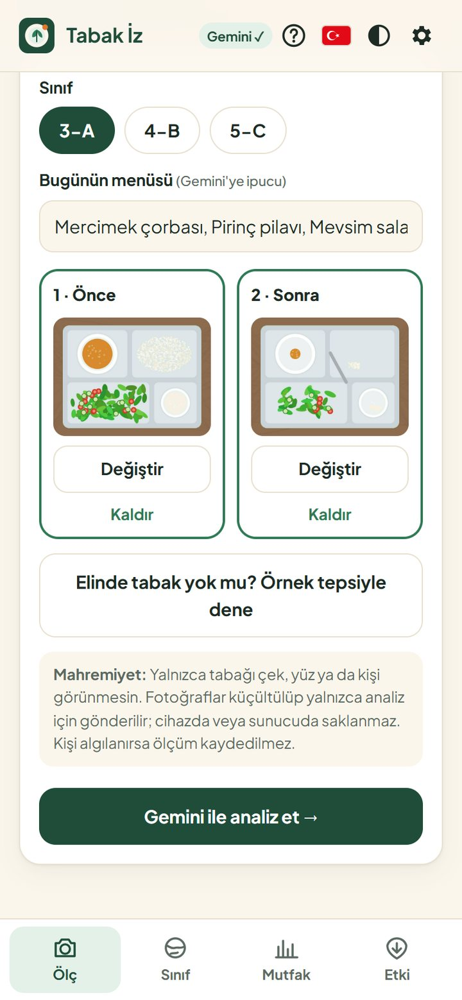
  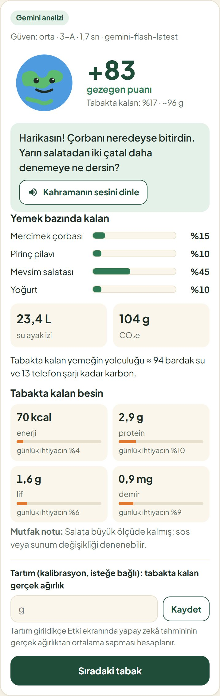
  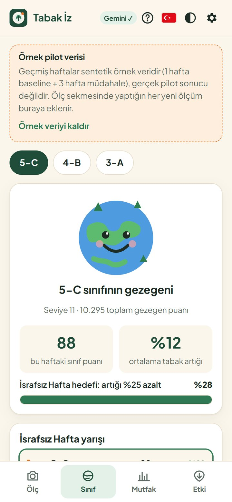
  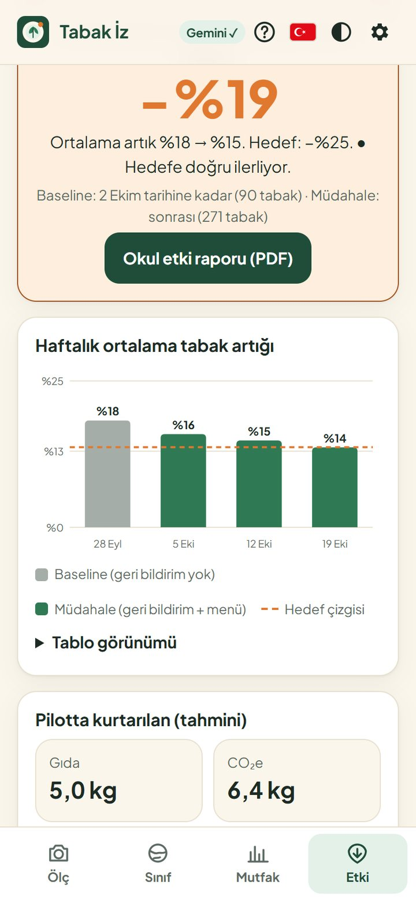
</p>

## Problem

> Bu bölümdeki rakamların kaynakları ve dünya karşılaştırması: [docs/BENCHMARK.md](docs/BENCHMARK.md) ve uygulamadaki **Kanıt** sekmesi.

Okul yemekhanelerinde çocukların tabağında hangi yemeğin ne kadar kaldığı **sistematik olarak ölçülmüyor**. Ölçüm olmadığı için mutfak menüyü veriyle iyileştiremiyor, çocuk da israfın sonucunu göremiyor.

- Türkiye'de bir okulda tabak artığı yemek maliyetinin **~%15**'ine ulaşıyor (Gaziantep, 300 öğrenci).
- Dünyada da durum benzer: ABD'de okul öğle yemeği kalorilerinin **~%20**'si, ilkokullarda **%25'ten fazlası** (USDA, 6.253 tepsi); İtalya'da 78 ilkokulda hazırlanan yemeğin **%16,7**'si tabakta kalıyor. En çok kalan grup her yerde **sebze**.
- Mevcut çalışmalar tek seferlik ve elle tartıma dayanıyor. Okul yemeği israfını **sürekli ölçen bir sistem yok**.
- MEB 2025-2026'da ~1,36 milyon öğrenciye beslenme desteği veriyor ve yaygınlaştırma için ihtiyaç analizi yürütüyor. Ölçülmeyen her yeni porsiyon, ölçeklenen bir israf riski demek.

## Çözüm: Ölç → Anlat → Düzelt → Kanıtla

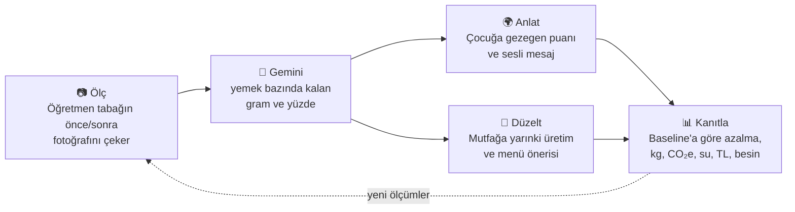

Özel donanım gerekmez; öğretmenin telefonu veya tableti yeterli.

## Ekran görüntüleri

> Ekran görüntüleri uygulamadaki **sentetik örnek pilot verisiyle** alınmıştır; bu veri uygulamada da "Örnek pilot verisi" olarak etiketlidir.

### Ölç: tabak fotoğrafından Gemini analizine

<table>
  <tr>
    <td align="center" width="25%"><br><sub>Önce/sonra fotoğrafı, örnek tepsi, mahremiyet notu</sub></td>
    <td align="center" width="25%">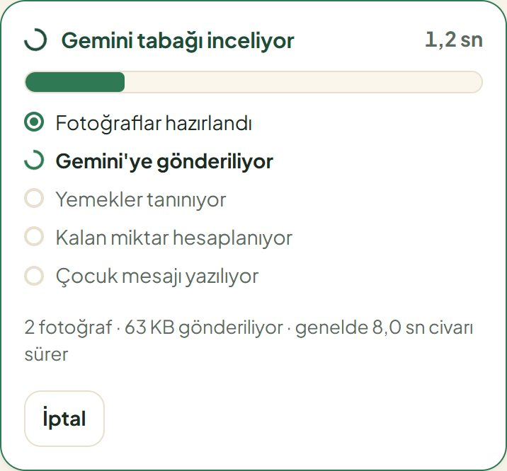<br><sub>Analiz sırasında süre ve aşamalar</sub></td>
    <td align="center" width="25%">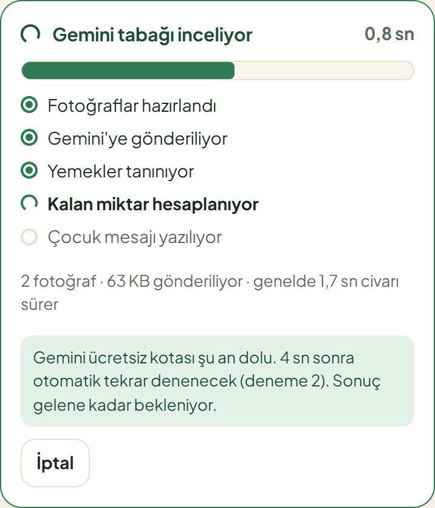<br><sub>Kota dolunca bekleyip otomatik tekrar deneme</sub></td>
    <td align="center" width="25%"><br><sub>Gezegen puanı, sesli mesaj, yemek bazında artık, su/CO₂e, besin kaybı, tartım kalibrasyonu</sub></td>
  </tr>
</table>

### Sınıf ve mutfak

<table>
  <tr>
    <td align="center" width="25%"><br><sub>Sınıfın gezegeni, İsrafsız Hafta hedefi ve yarışı</sub></td>
    <td align="center" width="25%">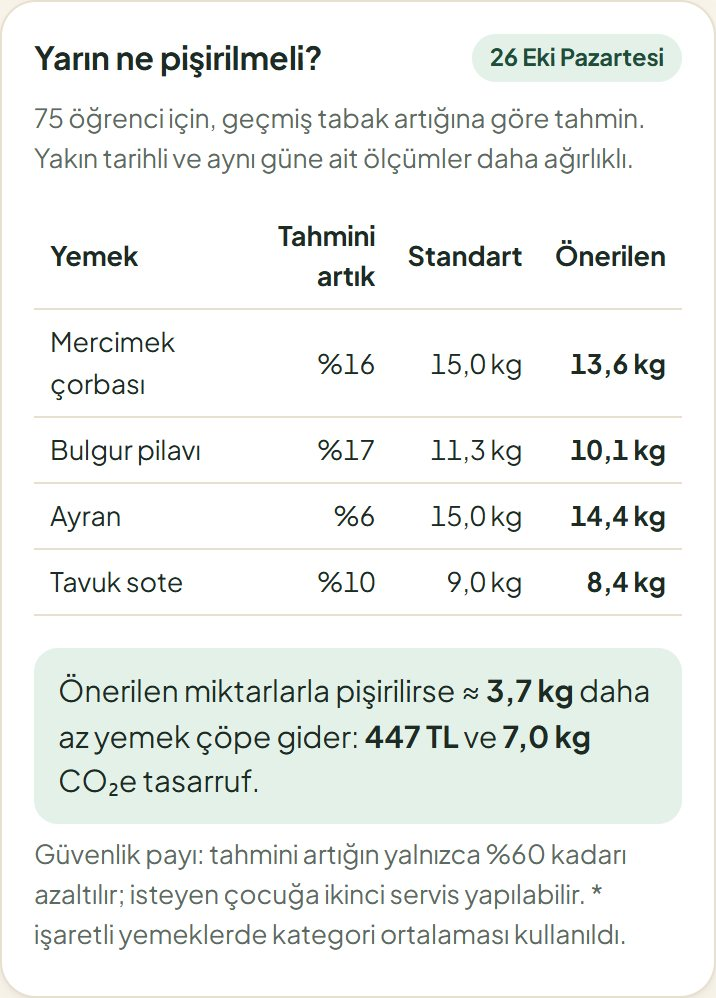<br><sub>"Yarın ne pişirilmeli?" üretim tahmini</sub></td>
    <td align="center" width="25%">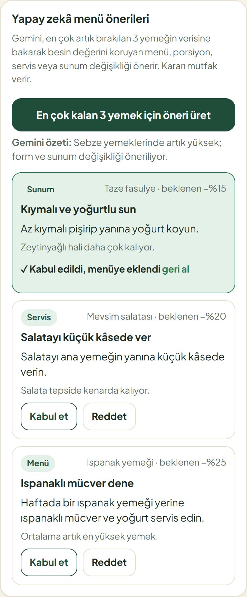<br><sub>Gemini menü önerileri; kabul/ret mutfakta</sub></td>
    <td align="center" width="25%">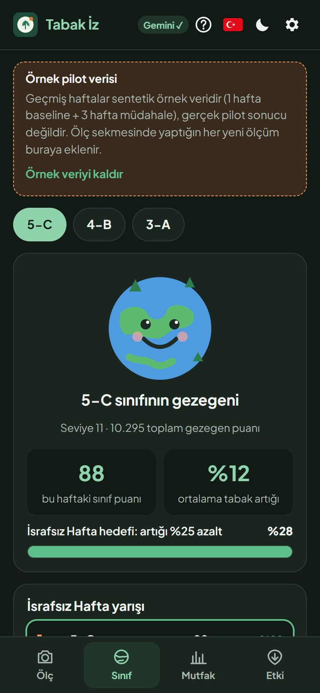<br><sub>Koyu tema</sub></td>
  </tr>
</table>

### Etki, doğrulama ve rapor

<table>
  <tr>
    <td align="center" width="25%"><br><sub>Baseline'a göre göreli değişim ve haftalık trend</sub></td>
    <td align="center" width="25%">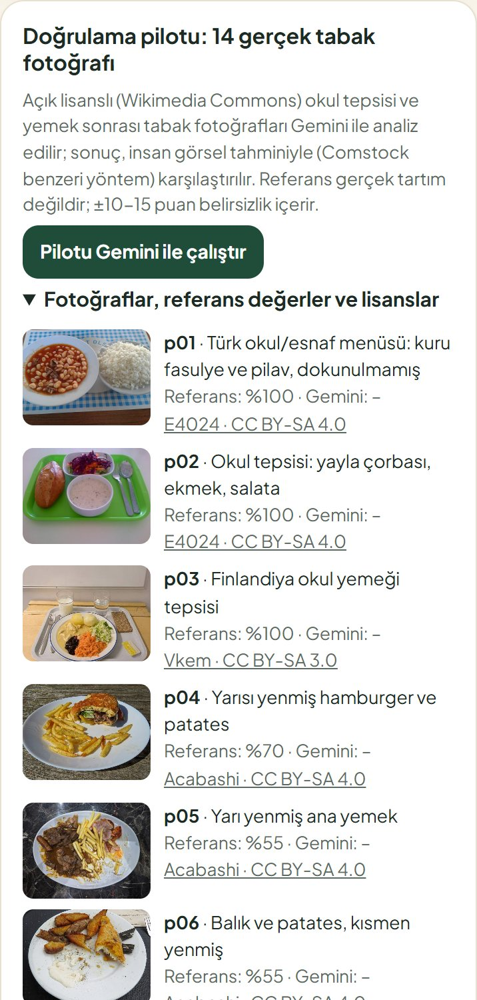<br><sub>14 açık lisanslı gerçek fotoğrafla doğrulama pilotu</sub></td>
    <td align="center" width="50%" colspan="2">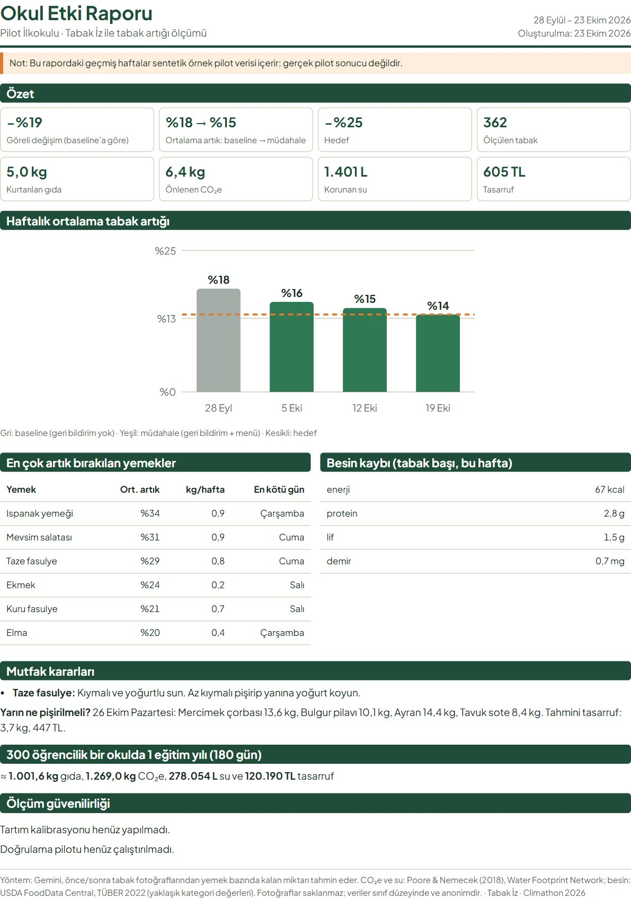<br><sub>Tek dokunuşla okul etki raporu (PDF)</sub></td>
  </tr>
</table>

### Kanıt ve benchmark

<table>
  <tr>
    <td align="center" width="25%">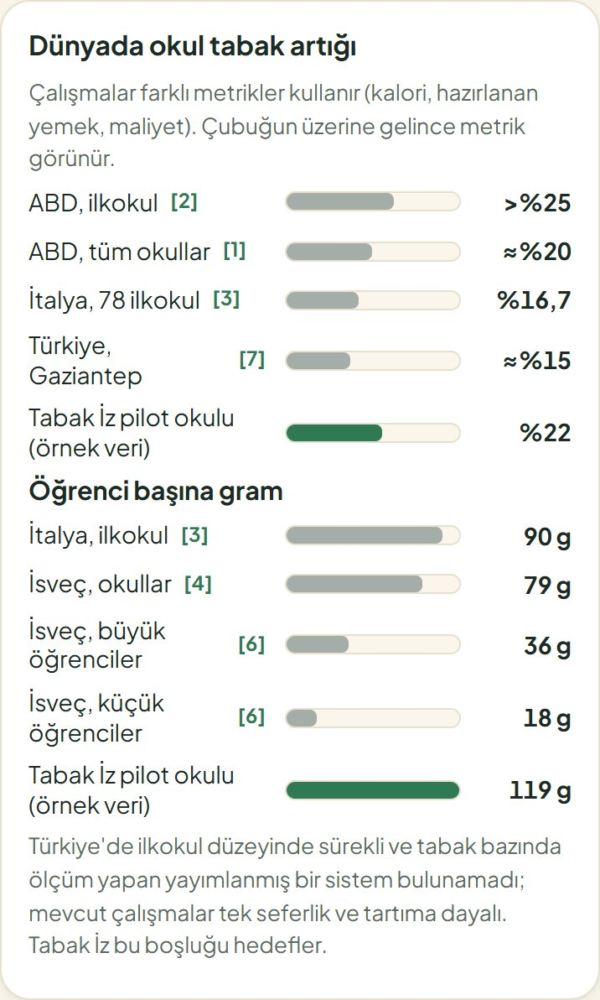<br><sub>Dünyada okul tabak artığı (kaynaklı)</sub></td>
    <td align="center" width="25%">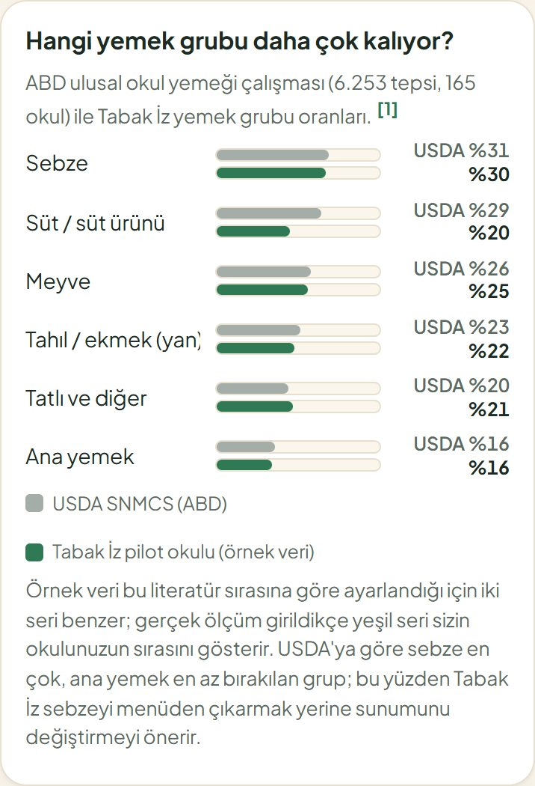<br><sub>Yemek grubuna göre: USDA ve Tabak İz</sub></td>
    <td align="center" width="25%">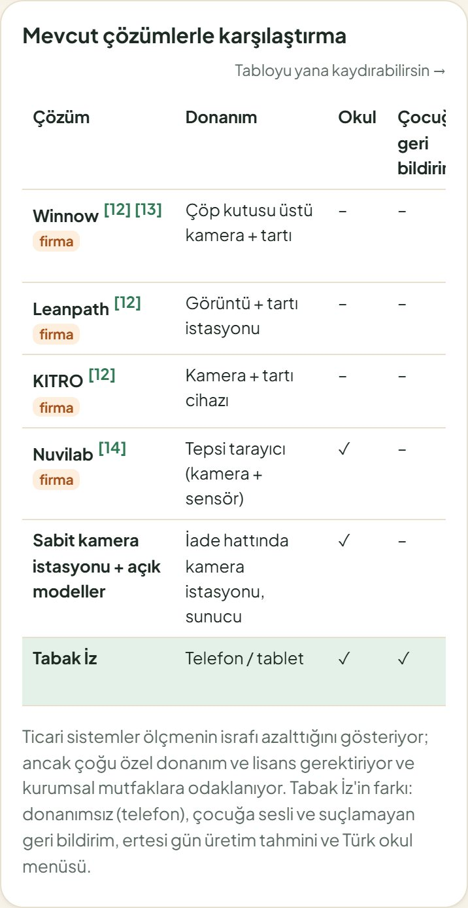<br><sub>Mevcut çözümlerle karşılaştırma</sub></td>
    <td align="center" width="25%">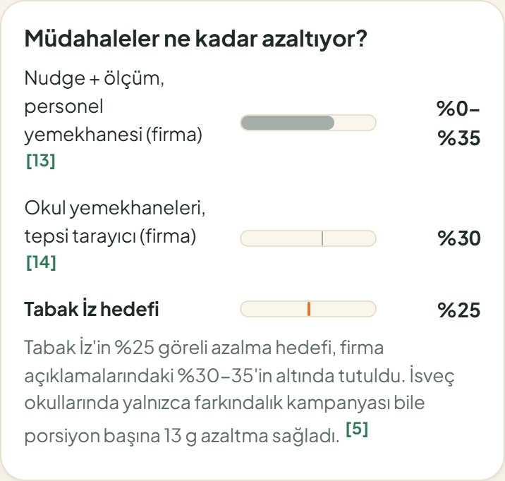<br><sub>Müdahalelerin etkisi ve %25 hedefimiz</sub></td>
  </tr>
</table>

### Jüri turu ve dil seçimi

<table>
  <tr>
    <td align="center" width="25%">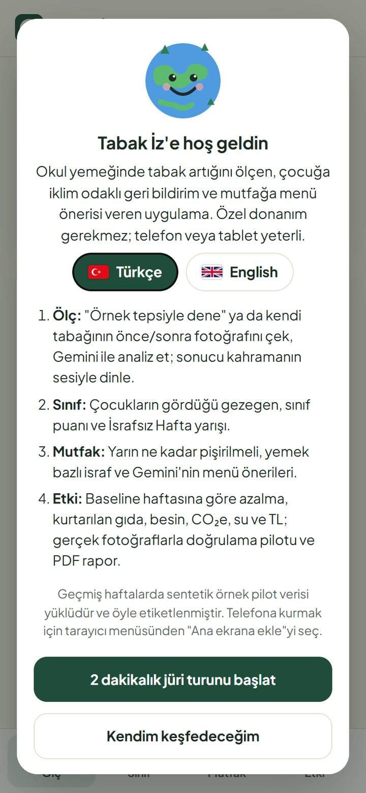<br><sub>Karşılama ve dil seçimi</sub></td>
    <td align="center" width="25%">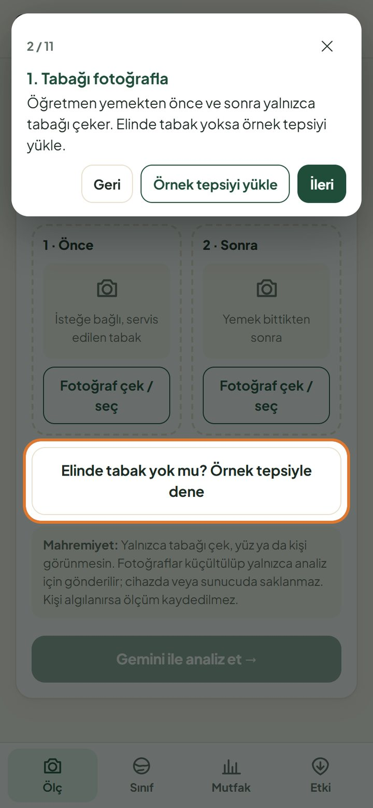<br><sub>2 dakikalık rehberli jüri turu</sub></td>
    <td align="center" width="25%">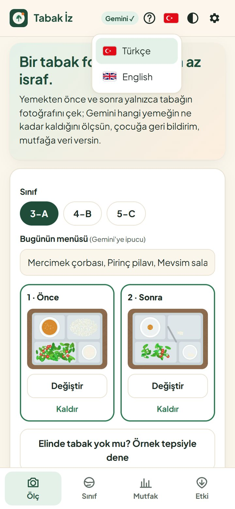<br><sub>Türkçe / İngilizce dil menüsü</sub></td>
    <td align="center" width="25%">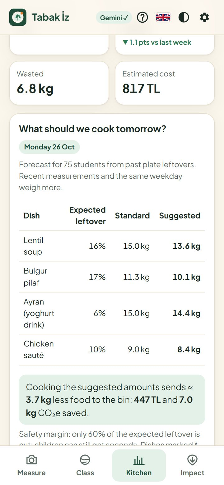<br><sub>İngilizce arayüz ve Gemini çıktıları</sub></td>
  </tr>
</table>

<p align="center">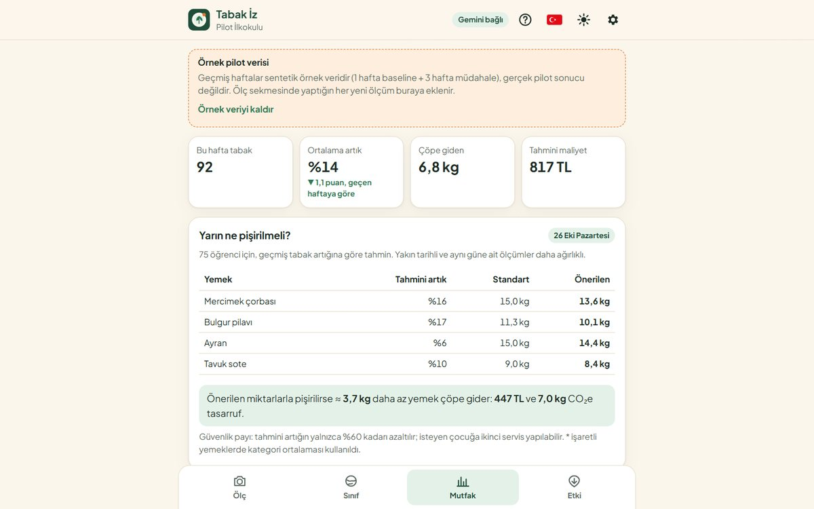<br><sub>Tablet ve masaüstünde aynı uygulama</sub></p>

## Özellikler

| Ekran | Ne yapıyor? |
|---|---|
| **Ölç** | Önce/sonra fotoğrafı (ya da yalnızca sonrası) → Gemini yemekleri tanır, her yemek için servis gramını ve kalan yüzdeyi ölçer. Sonuç: gezegen puanı, çocuğa suçlamayan mesaj ve bu mesajın **duygulu sesle okunması**, su ve CO₂e karşılığı, **besin kaybı** (enerji, protein, lif, demir; günlük ihtiyacın yüzdesi), isteğe bağlı **tartım kalibrasyonu**. |
| **Sınıf** | Çocukların gördüğü ekran: sınıfın gezegeni, seviye, İsrafsız Hafta hedefi ve yarışı, rozetler, "kahraman enerjisi", paylaşılabilir veli özeti. Puan bireysel değil, **sınıf ortalamasıyla** verilir. |
| **Mutfak** | **Yarın ne pişirilmeli?** (yemek bazında tahmini artık ve önerilen kg), yemek bazında israf grafiği, en çok kalan 3 yemek için **Gemini menü önerisi**; kabul ya da ret mutfakta. |
| **Etki** | Baseline haftasına göre göreli azalma, haftalık trend, kurtarılan gıda, CO₂e, su, TL ve besin; 300 öğrencilik okula yıllık ölçekleme; **okul etki raporu (PDF)**; CSV dışa aktarma. |
| **Kanıt** | **Benchmark:** dünyadaki okul artık oranları, yemek grubu karşılaştırması (USDA), ölçüm yöntemleri, rakip çözümler ve müdahale etkileri; her rakamın yanında tıklanabilir kaynak numarası. **İki doğrulama pilotu** ve 25 kaynaklı **kaynakça**. |

Bunlara ek olarak:
- **2 dakikalık rehberli jüri turu**: her adımda ilgili yeri vurgular, işlemi "Benim için yap" düğmesiyle çalıştırır.
- **Türkçe ve İngilizce**: arayüz, Gemini çıktıları, sesli geri bildirim ve PDF rapor seçili dilde.
- Açık/koyu tema; telefona kurulabilir ve çevrimdışı açılan PWA.

## Yapay zekâ ürünün içinde ne yapıyor?

| Görev | Nasıl |
|---|---|
| **Ölçüm motoru** | Gemini çok modlu görüntü analizi; yanıt **JSON şemasıyla** (structured output) gelir, sunucuda doğrulanıp değerleri sınırlanır. Kişi veya yüz algılanırsa ölçüm kaydedilmez. |
| **Çocuk dili** | Her tabağa özel, 6-13 yaşa uygun, suçlamayan ve tek küçük öneri içeren mesaj. |
| **Kahramanın sesi** | **Gemini TTS** mesajı sonuca göre seçilen tonla okur: artık azsa coşkulu kutlama, ortaysa sıcak ve cesaretlendirici, çoksa yumuşak ve umut veren. Gemini sesi alınamazsa tarayıcının konuşma sentezi devreye girer. |
| **Mutfak danışmanı** | En çok kalan yemeklerin verisinden, besin değerini koruyan ve Türk okul menüsüne uygun öneriler (ör. ıspanağı mücver formunda sunmak). |
| **Tahmin** | Geçmiş ölçümlerden zaman ağırlıklı model (yarı ömür 14 gün, aynı hafta günü ağırlığı) ile ertesi günün yemek bazlı artığı ve üretim miktarı. |

**Dayanıklılık:**
- **Yedek model zinciri:** `gemini-flash-latest → gemini-2.5-flash → gemini-flash-lite-latest → gemini-2.5-flash-lite`. Ücretsiz katmanda kota model başına işler; bir model kotaya takılınca ya da bulunamayınca sıradaki denenir. Kotası dolan model, Gemini'nin bildirdiği süre boyunca atlanır. Ses için de ayrı bir TTS model zinciri var.
- **Zaman aşımı yok:** Tüm modeller kotadaysa uygulama bekleyip sonuç gelene kadar otomatik tekrar dener ve bunu ekranda gösterir; yalnızca kullanıcı iptal ederse durur.
- **Hız:** Görüntüler cihazda 768 px'e küçültülür (Gemini'de tek karo, ~30-60 KB). Model düşük düşünme seviyesinde çalıştırılır (`thinkingLevel: low` / `thinkingBudget: 0`; desteklemeyen modelde otomatik kapanır). Sunucusuz fonksiyonlar kullanıcı butona basmadan önce uyandırılır.

## Etki hedefi ve doğrulama

| Gösterge | Baseline | Hedef |
|---|---|---|
| Tabak artığı | Türkiye'de ~%15 (maliyet, Gaziantep); dünyada %16,7 (İtalya) ile >%25 (ABD ilkokulları) | Kendi baseline haftamıza göre **%25 göreli azalma** |
| Ölçüm kapsamı | %0 | Pilot sınıflarda her öğün |
| 300 öğrencilik okul, 1 yıl | | ≈ **1 ton gıda**, **1,3-2,5 ton CO₂e**, **~120.000 TL** |

**İki doğrulama pilotu** (Kanıt sekmesinden tek dokunuşla çalışır):

| Pilot | Veri | Referans | Ne ölçülüyor? |
|---|---|---|---|
| 1. Görsel | 14 açık lisanslı (CC BY-SA) gerçek tabak fotoğrafı: Türk okul menüleri, okul tepsileri, yarım ve bitmiş tabaklar | İnsan görsel tahmini (Comstock benzeri; ±10-15 puan belirsizlik) | Artık yüzdesi: ortalama mutlak hata, ±15 puan içindeki oran, korelasyon |
| 2. Terazi | 16 kafeterya tabağı, **Google Nutrition5k** (CC BY 4.0) | **Terazide tartılmış gerçek kütle ve kalori** | Gram tahmini: ortalama yüzde hata, ±%25 içindeki oran, kalori hatası |

Sahada ise sonuç ekranına girilen gerçek tartımla yapay zekâ tahmininin sapması otomatik raporlanır. Ayrıntılar ve sınırlılıklar: [docs/BENCHMARK.md](docs/BENCHMARK.md).

**Benchmark özeti:** Ticari sistemler (Winnow, Leanpath, KITRO, Nuvilab) ölçmenin israfı azalttığını gösteriyor; firmalar %30-35 azalma bildiriyor. Ancak bu sistemler özel kamera ve tartı donanımı ile lisans gerektiriyor ve çoğu kurumsal mutfaklara odaklanıyor. Tabak İz'in %25 hedefi firma açıklamalarının altında tutuldu. Fark: donanım gerektirmiyor, çocuğa sesli ve suçlamayan geri bildirim veriyor, ertesi gün üretim tahmini yapıyor.

## Mimari

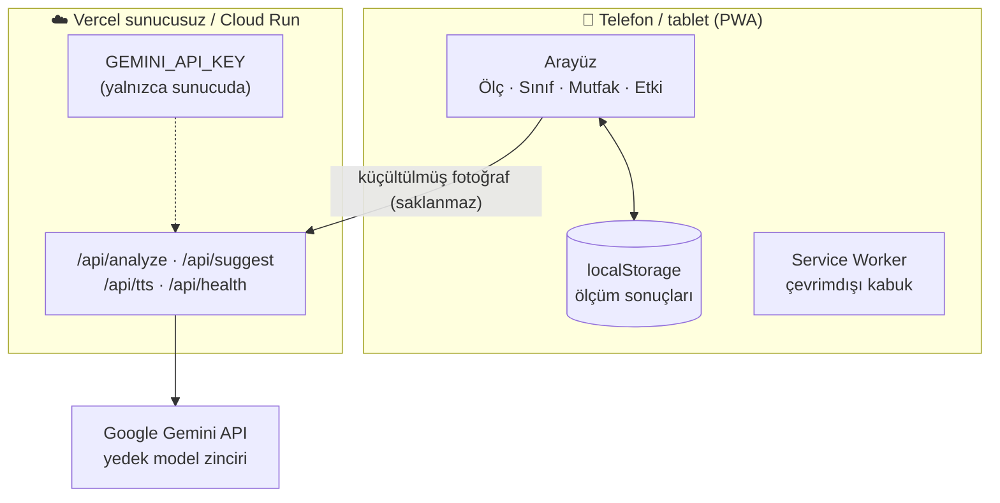

- **Bağımlılık yok:** Uygulama düz HTML/CSS/JavaScript (ES modülleri), sunucu Node.js 18+ yerleşik modülleri; `npm install` gerekmez.
- **Veri:** Ölçüm sonuçları cihazda (`localStorage`) tutulur, sunucuda veritabanı yoktur. **Fotoğraflar hiçbir yerde saklanmaz.**
- **Anahtar güvenliği:** Gemini anahtarı yalnızca sunucuda durur; jüri anahtar girmeden kullanır. Sunucuda istek boyutu ve IP başına hız sınırı var.

## Çalıştırma

```bash
cp .env.example .env    # GEMINI_API_KEY=... (https://aistudio.google.com/apikey)
node server.js          # http://localhost:8080
```

Anahtar yoksa uygulama **Demo modunda** açılır ve örnek sonuçlar gösterir. Ayarlar'dan kendi anahtarını girerek tarayıcıdan doğrudan Gemini'ye de bağlanabilirsin.

**Yayına alma** (Vercel, Cloud Run), telefona kurulum, pilotu çalıştırma ve PDF rapor için: [docs/DEPLOY.md](docs/DEPLOY.md).

### Ortam değişkenleri

| Değişken | Zorunlu | Açıklama |
|---|---|---|
| `GEMINI_API_KEY` | Evet | Google AI Studio API anahtarı |
| `GEMINI_MODELS` | Hayır | Model zincirinin tamamı, virgülle (ör. `gemini-2.5-flash,gemini-2.5-flash-lite`) |
| `GEMINI_MODEL` | Hayır | Yalnızca birincil modeli değiştirir; yedekler arkasından gelir |
| `GEMINI_TTS_MODEL` | Hayır | Önce denenecek TTS model(ler)i, virgülle |

## Proje yapısı

```
public/                   PWA (tarayıcıda çalışan uygulama)
  index.html, styles.css  kabuk ve stiller (açık/koyu tema, yazdırma görünümü)
  js/app.js               ekranlar ve etkileşim
  js/ai.js                Gemini erişimi (sunucu → kendi anahtar → demo), tekrar deneme, görüntü küçültme
  js/store.js             cihazdaki veri, örnek pilot verisi, toplulaştırmalar
  js/metrics.js           etki hesapları (ekran ve rapor ortak)
  js/forecast.js          "Yarın ne pişirilmeli?" tahmini
  js/impact.js            CO₂e, su ve besin katsayıları
  js/voice.js             duygulu sesli geri bildirim (Gemini TTS + tarayıcı yedeği)
  js/pilot.js             iki doğrulama pilotu (görsel tahmin ve terazi)
  js/evidence.js          benchmark verisi ve numaralı kaynakça (Kanıt sekmesi)
  js/report.js            okul etki raporu (yazdır → PDF)
  js/tour.js              rehberli jüri turu
  js/i18n.js, i18n-en.js  dil desteği ve bayraklar (Türkçe kaynak, İngilizce sözlük)
  js/charts.js            SVG grafikler
  shared/gemini-core.js   prompt'lar, JSON şemaları, yedek model zinciri (sunucu ve tarayıcı ortak)
  pilot/                  14 açık lisanslı doğrulama fotoğrafı + manifest.json
  pilot/mass/             16 Nutrition5k tabağı (terazi ölçümlü) + manifest.json
api/                      Vercel sunucusuz uçları
lib/handlers.js           uçların ortak mantığı (gizli anahtar, hız sınırı, model zinciri)
server.js                 yerel / Cloud Run sunucusu
docs/                     teslim dokümanları, yayın rehberi, benchmark, ekran görüntüleri
```

## Mahremiyet

- Yalnızca tabak fotoğrafı çekilir; Gemini kişi veya yüz algılarsa ölçüm kaydedilmez.
- Fotoğraflar cihazda küçültülür, meta verisi (EXIF/konum) silinir ve yalnızca analiz için gönderilir; **saklanmaz**.
- Veriler sınıf düzeyinde, öğrenci adı olmadan ve yalnızca cihazda tutulur.

## Kaynaklar

Uygulamadaki tüm dış rakamlar numaralı kaynaklara dayanır. Tam kaynakça (18 kaynak, bağlantılarıyla) **Kanıt** sekmesinde ve [docs/BENCHMARK.md](docs/BENCHMARK.md) dosyasındadır. Başlıcaları:

- **Okul tabak artığı:** USDA School Nutrition and Meal Cost Study (2019); *Who Cleans the Plate?* İtalya 78 ilkokul (Sustainability, 2025); Eriksson vd. (2017) ve Malefors vd. (2022, 2025), İsveç; Byker Shanks vd. (2017) sistematik derlemesi; Gaziantep okul yemekhanesi çalışması (Hasan Kalyoncu Üniv.).
- **Ölçüm yöntemleri:** hastane fotoğraf validasyonu (British Food Journal, 2025); YOLOv11 ve U-Net kafeterya çalışmaları (Applied Sciences, 2025).
- **Çözümler ve etki:** Frontiers in AI derlemesi (2024); Winnow/Melco/LSE (2021, firma); Nuvilab (2022, firma).
- **Katsayılar ve veri setleri:** Poore & Nemecek (2018), Water Footprint Network, FAO, USDA FoodData Central, TÜBER 2022, UNEP Food Waste Index 2024, Nutrition5k (CVPR 2021).

## Lisanslar

- `public/pilot/` içindeki fotoğraflar **Wikimedia Commons**'tan alınmıştır (CC BY-SA 3.0 / 4.0) ve 768 px'e küçültülmüştür. Yazar, lisans ve kaynak bağlantıları [`public/pilot/manifest.json`](public/pilot/manifest.json) dosyasında ve uygulamada pilot kartının altında listelenir.
- `public/pilot/mass/` içindeki tabaklar ve ölçümleri **Nutrition5k** veri setindendir (Thames vd., CVPR 2021; **CC BY 4.0**). Tabak kimlikleri ve özgün görüntü bağlantıları [`public/pilot/mass/manifest.json`](public/pilot/mass/manifest.json) dosyasındadır.

---

<sub>Tabak İz · Climathon 2026 · Mert Uçan</sub>
